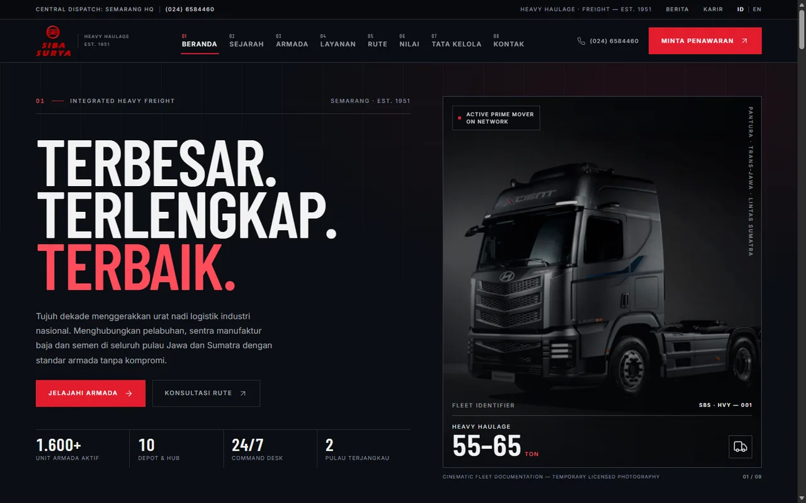
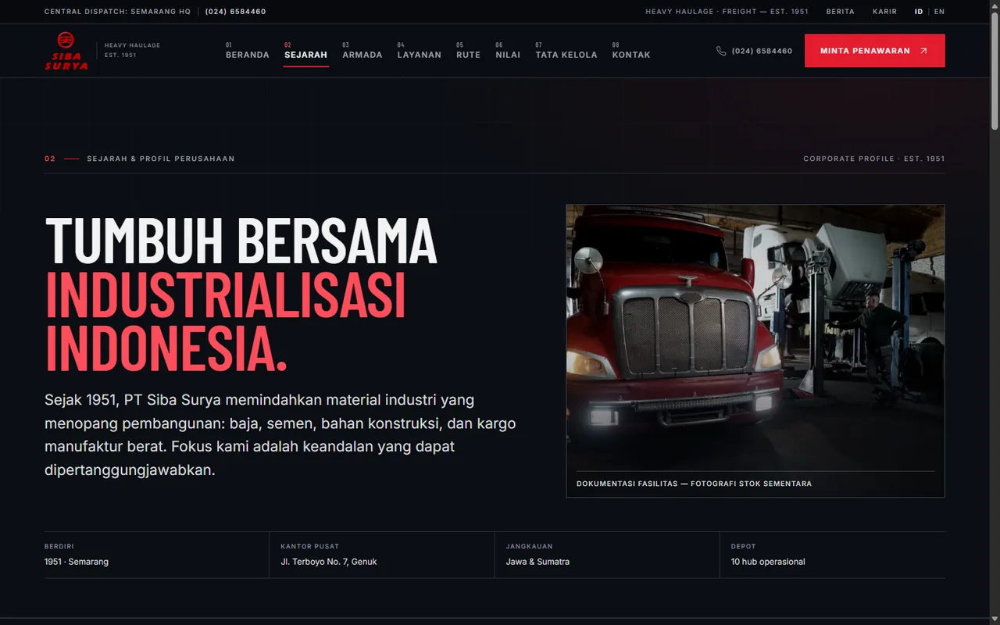
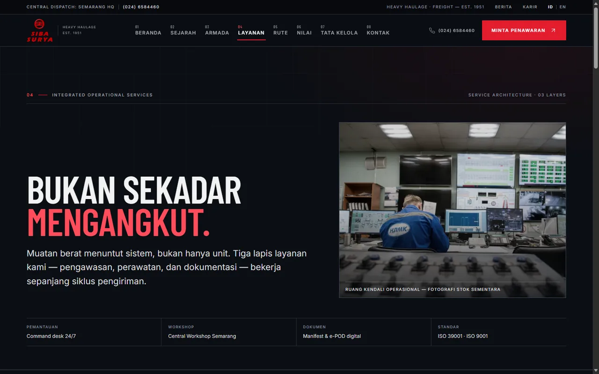
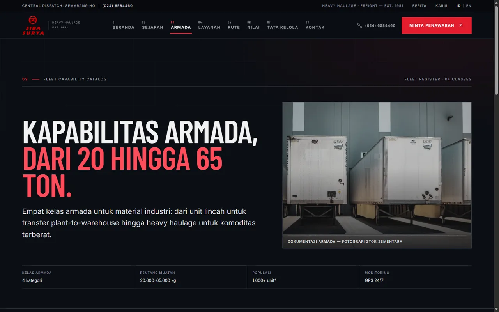
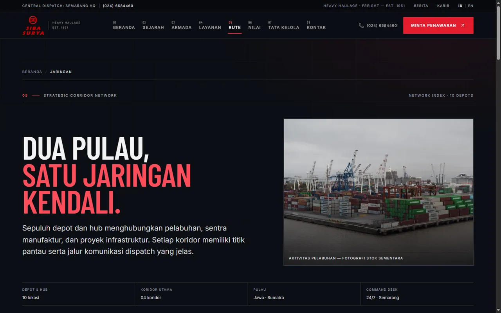
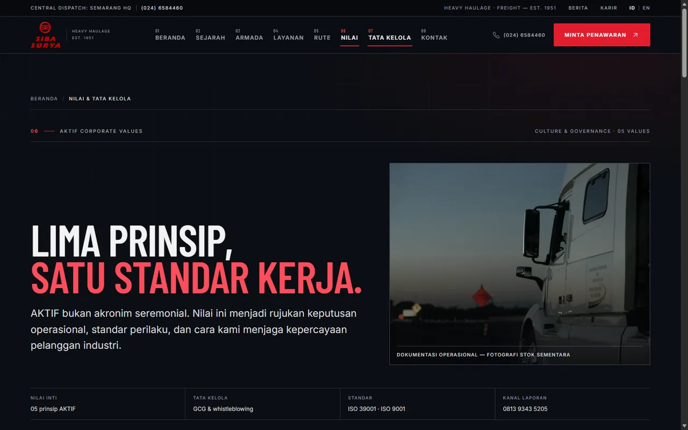
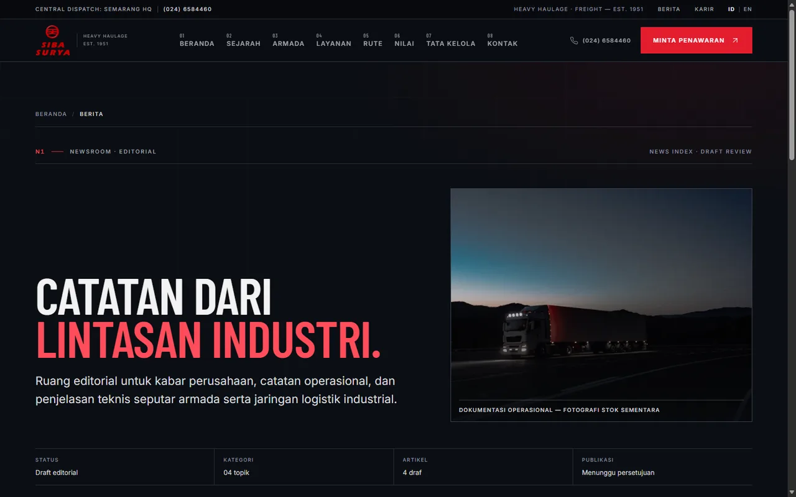
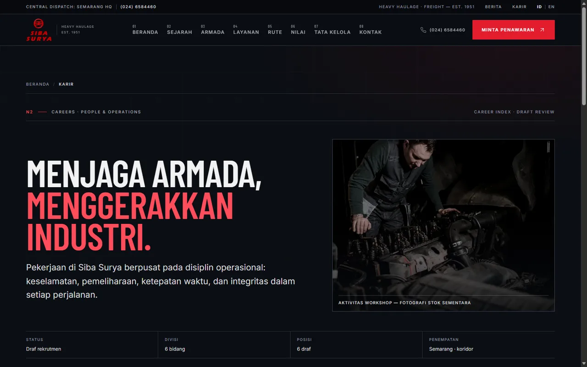
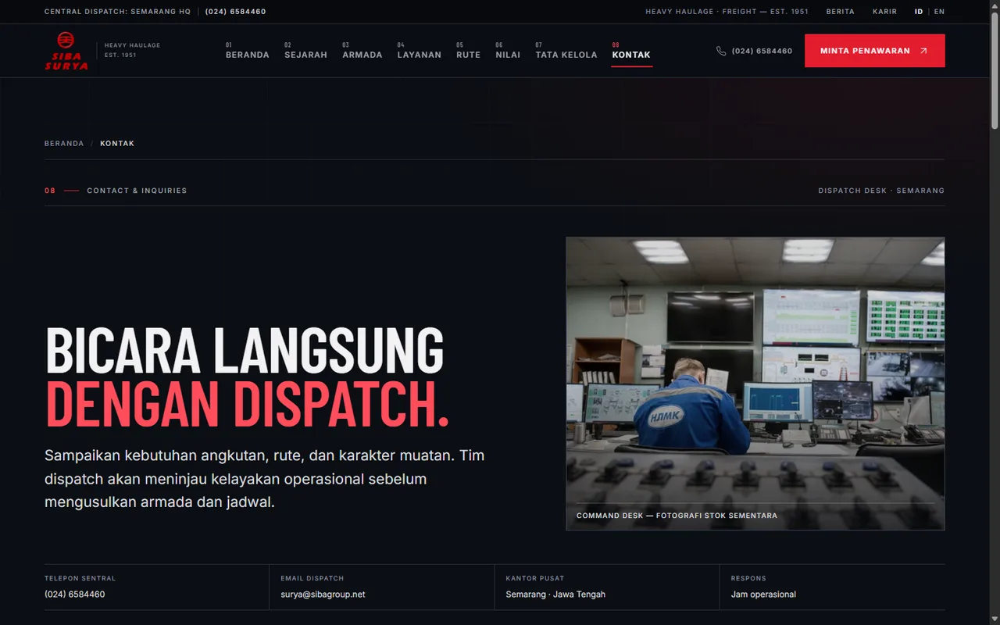
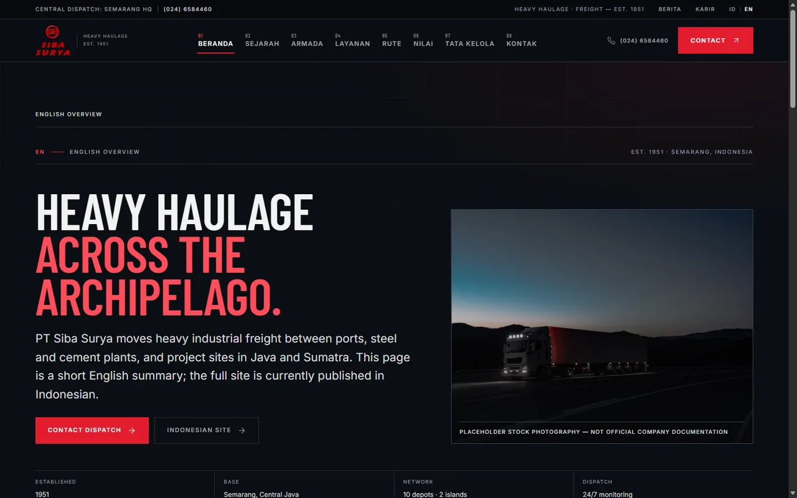

# PT Siba Surya — Website Reimagined

Website company profile PT Siba Surya, perusahaan transportasi darat muatan berat dan logistik industrial sejak 1951. Menampilkan armada, layanan, jaringan koridor Jawa–Sumatra, nilai perusahaan, berita, karier, dan formulir kontak.

Dibangun sebagai situs statis dengan Astro, TypeScript, Tailwind CSS, dan optimasi gambar Astro Assets. Konten terpusat di `src/data/`, akses data melalui `src/lib/api/`, serta desain responsif dengan tema industrial gelap.

## Tampilan Halaman

| | |
| :---: | :---: |
| **Beranda**  | **Tentang**  |
| **Layanan**  | **Armada**  |
| **Jaringan**  | **Nilai**  |
| **Berita**  | **Karier**  |
| **Kontak**  | **English Overview**  |

> Screenshot diambil pada viewport 1440×900. Foto masih placeholder dan berita/lowongan masih berstatus draft.
